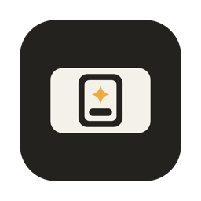

<div align="center">
  
  <h1>TapAsk</h1>
  <p><strong>把常用 AI 放进一个随手呼出的浮窗。</strong></p>
  <p>需要时打开，问完后收起，继续手头的事。</p>
  <p>ChatGPT · Claude · Gemini · DeepSeek · Grok · 豆包</p>
  <p>
    <a href="https://github.com/Sure-Will/tap-ask/releases/download/v0.1.9/TapAsk-0.1.9-macOS.dmg"><strong>下载 macOS</strong></a> ·
    <a href="https://github.com/Sure-Will/tap-ask/releases/download/v0.1.9/TapAsk-win-Setup.exe"><strong>下载 Windows</strong></a> ·
    <a href="https://github.com/Sure-Will/tap-ask/releases/download/v0.1.9/TapAsk-win-Portable.zip">Windows 便携版</a>
  </p>
  <p>当前下载为 0.1.9 · <a href="https://github.com/Sure-Will/tap-ask/releases">查看所有版本</a></p>
</div>

## TapAsk 能做什么

TapAsk 把六家 AI 网站放在同一个小窗口里。你可以在写代码、读文档或处理其他事情时打开它，问完再回到原来的窗口。

- **快捷呼出**：按快捷键显示或收起浮窗，也可以点击菜单栏或系统托盘图标。呼出快捷键可以自己改。
- **切换六家服务商**：在 ChatGPT、Claude、Gemini、DeepSeek、Grok 和豆包之间切换，还可以调整顺序。第一次打开默认进入 DeepSeek，以后恢复上次使用的服务商。
- **接着上次聊**：各家网站的登录状态保存在本机，重新打开时尝试恢复上次停留的页面。最近使用的后台页面会暂时保留。
- **放在顺手的位置**：窗口可以置顶、拖动和缩放，记住大小与位置；呼出时会根据鼠标所在的屏幕调整位置。
- **后台更新**：发布版默认检查并下载更新；下载后可从菜单立即安装并重启，正常退出时也会安装。

## 下载与安装

| 平台 | 下载 | 系统要求 |
| --- | --- | --- |
| macOS | [通用安装包](https://github.com/Sure-Will/tap-ask/releases/download/v0.1.9/TapAsk-0.1.9-macOS.dmg) | macOS 14 或更高版本，支持 Apple 芯片和 Intel |
| Windows | [安装版](https://github.com/Sure-Will/tap-ask/releases/download/v0.1.9/TapAsk-win-Setup.exe) · [便携版](https://github.com/Sure-Will/tap-ask/releases/download/v0.1.9/TapAsk-win-Portable.zip) | Windows x64，需要 WebView2 Runtime |

### macOS

打开下载的 DMG，把 `TapAsk.app` 拖进“应用程序”，然后打开。TapAsk 会出现在菜单栏，单击图标显示或收起浮窗，右键打开菜单；Dock 中不显示图标。

第一次从“应用程序”打开时，TapAsk 会尝试将自己加为登录项。如果不需要，可以在“系统设置 › 通用 › 登录项”中关闭。

<details>
<summary>第一次打开时被 macOS 拦下？</summary>

TapAsk 尚未经过 Apple 公证。被拦下后，在“系统设置 › 隐私与安全性”中找到 TapAsk，选择“仍要打开”；也可以在终端运行：

```bash
xattr -dr com.apple.quarantine /Applications/TapAsk.app
```

</details>

### Windows

运行安装版，或者将便携版解压到固定位置，双击其中的 `TapAsk.exe`。两种版本都需要 [WebView2 Runtime](https://developer.microsoft.com/microsoft-edge/webview2/)。

运行后，在任务栏右侧的系统托盘找到 TapAsk 图标。单击显示或收起浮窗，右键打开菜单；图标不在外面时，可以查看托盘的隐藏图标。

安装包尚未进行 Windows 代码签名，系统可能提示发布者未知。Windows 版的真实账号登录、跨屏和安装升级等场景仍需进一步实机验收。

## 怎么用

| 操作 | macOS | Windows |
| --- | --- | --- |
| 显示或收起浮窗 | ⌥空格 | Alt+空格 |
| 切换第 1 到第 6 个服务商 | ⌘1 到 ⌘6 | Ctrl+1 到 Ctrl+6 |
| 重新加载当前页面 | ⌘R | Ctrl+R |
| 打开快捷键设置（浮窗在前台时） | ⌘, | Ctrl+, |

表中显示默认的呼出快捷键，服务商编号随菜单中的排序变化。右键菜单栏或托盘图标可以选择服务商，并调整排序、快捷键、自启与更新。快捷键和排序在图标附近的小面板中设置。

拖动浮窗顶部中央的短白条可以移动窗口，拖动边缘可以调整大小。

## 常见问题

**快捷键没有反应怎么办？**

先确认 TapAsk 正在运行，再单击菜单栏或托盘图标打开浮窗。右键菜单栏或托盘图标，选择“设置快捷键…”。macOS 组合键须包含 ⌘、⌥ 或 ⌃，Windows 须包含 Ctrl 或 Alt；都可以加 Shift。注册失败时会保留原设置；系统不一定能报告所有冲突，保存后请实际按键确认。

**收起浮窗和退出有什么区别？**

收起后 TapAsk 仍在运行。Mac 隐藏满 30 分钟会释放当前页面，再次呼出时重新加载；Windows 隐藏时会降低网页的内存目标。要完全退出，请在菜单栏或托盘的右键菜单中选择“退出 TapAsk”。发布版默认每天在后台检查更新，下载好的更新会在正常退出后安装；当前网页状态无法可靠确认时，不会主动静默重启。更新下载后可从菜单选择“立即安装并重启”。更新会保留登录数据、服务商顺序和窗口偏好，但不保证保留未发送的网页草稿。

macOS 上也可以在菜单栏选择“检查更新…”。Mac 版 0.1.3 及更早版本需要先手动替换一次，之后才能使用自动更新。

**切换服务商后，页面会一直留在后台吗？**

TapAsk 最多保留当前和最近使用的一家页面。打开第三家，或后台页面闲置满 5 分钟后，较久未用的页面会被释放，切回时重新加载。登录数据不会因此清除，但未发送的草稿、滚动位置或正在生成的回答可能丢失或中断。登录弹窗不受页面自动释放影响。

**账号和聊天内容在哪里？**

登录和对话都通过你选择的服务商网页进行，TapAsk 不收集聊天内容或账号资料。导航日志记录服务商、主机名、阶段和结果，不记录完整网址或网页标题；Windows 更新组件的本机诊断日志可能记录安装路径。

**外部链接和文件下载能用吗？**

macOS 上，用户点击的合规外部链接会交给默认浏览器。Windows 上可以右键符合导航规则的外链，选择“在默认浏览器中打开”；直接点击暂不会自动转交。浮窗内的文件下载暂不可用。

## 从源码构建

macOS 需要 Xcode Command Line Tools（Swift 6）；Windows 需要 .NET 10 SDK 和 WebView2 Runtime。

```bash
# macOS
cd macos
swift test --disable-sandbox
scripts/build-app.sh
```

```powershell
# Windows
cd windows
.\scripts\verify.ps1
```

构建、测试、签名和打包的完整说明见 [开发与发布](docs/development.md)。产品行为和手工验收清单见 [行为约定](docs/behavior.md)。

## 许可证

[GPL-3.0](LICENSE)
